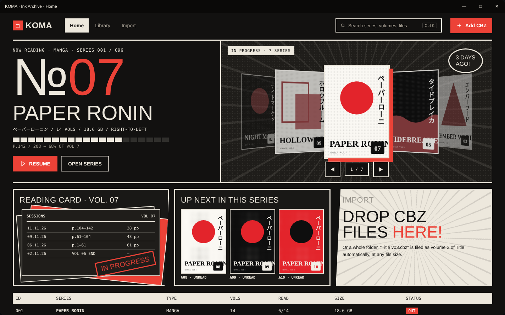
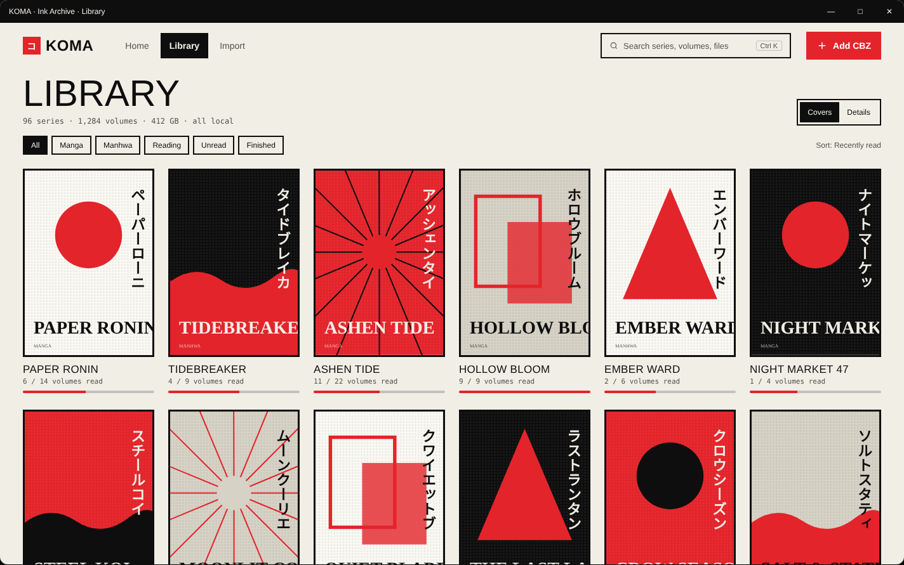
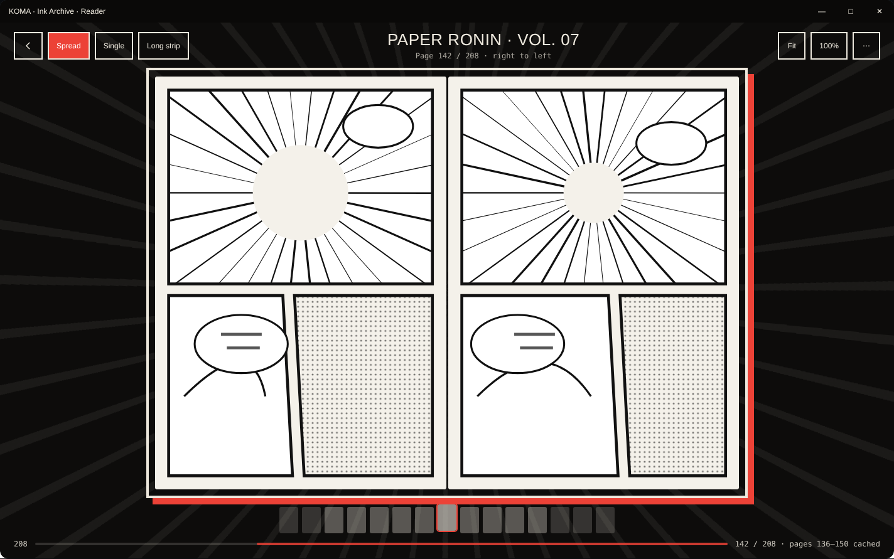
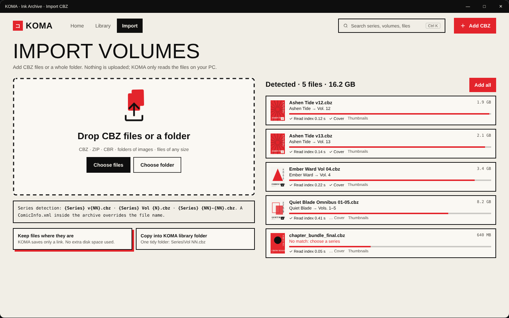
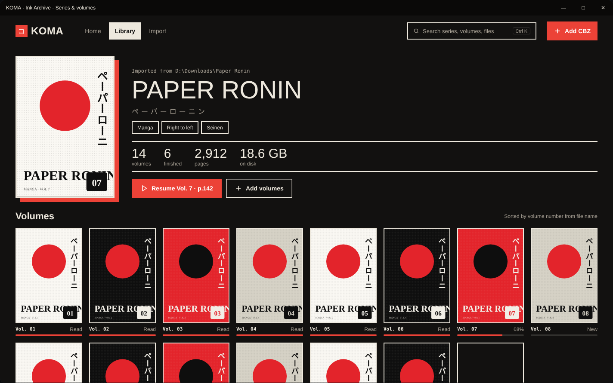

<p align="center">
  
</p>

<h1 align="center">KOMA</h1>

<p align="center">
  <b>A fast, offline manga and manhwa reader for Windows.</b><br>
  Your CBZ and PDF files, your PC. No accounts, no internet, no telemetry.
</p>

<p align="center">
  
  
  
  
  
  
</p>

<p align="center">
  
</p>

> The screenshots on this page come from the design reference in [`design/`](design/), so the
> covers are generated placeholders. In the app, the cover is the first page of each file.

## Why KOMA

Most readers choke on big files. KOMA is built around one rule: **never load a whole archive**.
It reads the ZIP index, then pulls single pages on demand, so a 10 GB omnibus opens as fast as
a 50 MB chapter.

- **Offline by design.** KOMA never talks to the network. There is nothing to sign in to.
- **Huge files are fine.** ZIP64 archives of 1 to 10+ GB open in milliseconds, with no extraction.
- **Original quality.** Pages are shown exactly as they are stored. Nothing is resized or re-encoded.
- **PDF too.** Chapter PDFs and merged PDFs are volumes like any CBZ. Scanned pages are shown as the JPEGs inside the PDF; other pages are drawn losslessly by PDFium.
- **Your files stay yours.** Keep them where they are, or let KOMA copy them into a library folder.

## Features

| | |
|---|---|
| **Library** | Each CBZ or PDF is a volume; volumes are grouped into series. Cover grid and details views, filters (manga, manhwa, reading, unread, finished), sorting and search (`Ctrl K`). |
| **Smart import** | Drop files or whole folders. Names such as `Title v03.cbz`, `Title Vol 3.cbz`, `Title 01-05.cbz` and `Title c012.pdf` are filed automatically, and `ComicInfo.xml` is used when present. |
| **Reader** | Spread (right-to-left or left-to-right), single page and long-strip modes, a thumbnail strip, full screen, and progress that is remembered per volume. |
| **Home** | A 3D cover carousel of what you are reading, a reading card with your recent sessions, and what is up next. |
| **Folder watching** | Point KOMA at your manga folders and it tells you when new files appear. Nothing is imported without you. |
| **Themes** | Light "paper" and dark "ink" themes, a red or orange accent, and a reduce-motion switch. |

<p align="center">
  
  
</p>
<p align="center">
  
  
</p>

## Design and motion

The look is called **Ink Archive**: ink and paper, one accent color, square corners, halftone
dots, speed lines and hard offset shadows instead of soft ones. The full system is in
[`docs/DESIGN.md`](docs/DESIGN.md).

Motion is part of the design, and it has rules:

| Name | Duration | Used for |
|---|---|---|
| micro | 140 ms | hover and press |
| ui | 260 ms | tabs, segments, cards rising in |
| page | 420 ms | screen changes |
| slam | 450 to 550 ms | panels, titles and stamps slamming in |
| carousel | 700 ms per step | the 3D cover carousel, which advances every 3.6 s and pauses on hover |

- Lists stagger in at 50 ms per item.
- The **reader itself does not animate**. Page turns are instant so nothing gets between you and the page.
- **Reduce motion** is respected: both the Windows setting and the in-app switch stop every loop
  (carousel, rotating bursts, marching ants) and make transitions instant.

## Supported files

| Format | How it is read |
|---|---|
| `.cbz`, `.zip` (including ZIP64) | The ZIP index is read, then single pages on demand. Pages are shown as stored. |
| `.pdf` (single chapters or merged) | Read on demand through PDFium. A page that is one JPEG scan is shown as that exact JPEG. Any other page (PNG-style images, several images, text) is drawn at the resolution of its images and shown as lossless PNG. |

A merged PDF is one volume. Password-protected PDFs are not supported. PDFs carry no
`ComicInfo.xml`, so the file name decides the series (`Title c012.pdf` is chapter 12 of Title).

## What's new in 1.0.2

- **PDF support.** Import chapter PDFs and merged PDFs by file, folder, drag-and-drop or watched
  folder. Covers, thumbnails, all three reader modes and progress work the same as for CBZ.
- Scanned PDF pages keep their original quality; nothing is re-encoded.
- The series files table shows the format of each file (`ZIP64 · stored`, `PDF · scans`,
  `PDF · rendered`).
- With "copy to library folder", PDFs are filed as `Series\Vol NN.pdf`.

## Install

1. Download `KOMA_x.y.z_x64-setup.exe` from the [Releases](../../releases) page.
2. Run it. KOMA installs for the current user, with no administrator rights needed.

An `.msi` installer is also built, for people who prefer it.

Windows may show a SmartScreen warning because the installer is not code-signed yet. Choose
**More info**, then **Run anyway**.

KOMA needs the WebView2 runtime, which is already part of Windows 11 and current Windows 10. The
installer fetches it if it is missing.

## Reader shortcuts

| Key | Action |
|---|---|
| `←` `→` | Turn the page (follows the reading direction) |
| `Space`, `Enter`, `Page Down` | Next page |
| `Shift` + `Space`, `Backspace`, `Page Up` | Previous page |
| `↑` `↓` | Scroll, in long-strip mode |
| `Home`, `End` | First page, last page |
| `1`, `2`, `3` | Spread, single page, long strip |
| `F` | Cycle fit: fit, width, actual size |
| `F11` | Full screen |
| `Esc` | Close the menu, leave full screen, or go back |

## Where your data lives

| What | Where |
|---|---|
| Library and settings (JSON) | `%APPDATA%\Koma` |
| Covers and thumbnails (safe to delete) | `%LOCALAPPDATA%\Koma\thumbs` |
| Files you chose to copy | `Documents\KOMA Library` (changeable in Settings) |

Removing a volume or series from KOMA never deletes the file on disk.

## Build from source

You need [Node.js](https://nodejs.org) (LTS), [Rust](https://rustup.rs) (stable, MSVC
toolchain) and the Visual Studio C++ build tools.

```bash
npm install
```

```bash
npm run tauri dev
```

```bash
npm run tauri build
```

The installers are written to `src-tauri/target/release/bundle/`.

PDF support needs `src-tauri/pdfium/pdfium.dll` (build 8125 from
[pdfium-binaries](https://github.com/bblanchon/pdfium-binaries)). It is in the repository and is
bundled into the installers; its licences are in `src-tauri/pdfium/`.

Tests:

```bash
cd src-tauri && cargo test
```

There is also a benchmark that writes a 6 GB archive to a temp folder, opens it, and deletes it:

```bash
cd src-tauri && cargo test benchmark_6gb -- --ignored --nocapture
```

To regenerate the icons and installer artwork from the logo:

```bash
npx tauri icon design/koma-icon.svg
```

```bash
powershell -File design/make-installer-art.ps1
```

## How it works

| Layer | Technology | Job |
|---|---|---|
| Shell | Tauri 2 | Frameless window, installer, the `koma://` protocol |
| UI | Angular (standalone components, signals) in `src/` | Screens; one feature folder each |
| Engine | Rust in `src-tauri/` | Everything that touches files: archive index, import, caches, thumbnails |

- **Archive engine.** Reads the ZIP / ZIP64 central directory only, then single entries on demand.
- **PDF engine.** PDFs are read on demand through [PDFium](https://pdfium.googlesource.com/pdfium/) (`pdfium.dll`, shipped with the app; licences in `src-tauri/pdfium/`). A page that is a single JPEG scan is served as that JPEG; anything else is drawn and served as PNG.
- **`koma://` protocol.** Page images go straight from Rust to `` tags. They never travel as
  base64 or JSON.
- **Background work.** File reading, decoding and thumbnailing run on worker threads, so the
  window never freezes.
- **No database.** The library is a small JSON file, written atomically.

More detail: [`docs/ARCHITECTURE.md`](docs/ARCHITECTURE.md).

## Security

KOMA opens files from anywhere, so the archive reader treats every file as untrusted:

- Sizes and offsets from the archive are bounds-checked before use, and a page that inflates to
  more than its index says is rejected.
- The UI runs under a strict Content Security Policy: no remote scripts, no remote connections.
- The window has only the permissions it needs (window controls and the file picker).
- Images are looked up by library id, so the `koma://` protocol cannot be used to read arbitrary files.

Found a problem? Please open an issue, or report it privately if it is sensitive.

## Contributing

Issues and pull requests are welcome. Before you start:

- Read [`docs/DESIGN.md`](docs/DESIGN.md) and [`docs/ARCHITECTURE.md`](docs/ARCHITECTURE.md).
- Never hard-code colors. Use the CSS variables in `src/styles/tokens.css`.
- Keep file work in Rust and off the UI thread.
- Add tests for changes to the archive, parser or library code, and run `cargo test`.
- Ask before adding a dependency that is not listed in the architecture document.

## License

KOMA is released under the [MIT License](LICENSE).

The bundled fonts (Anton, Archivo, IBM Plex Mono, Noto Sans JP) are under the SIL Open Font License.
